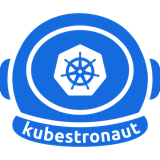
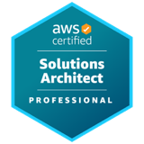
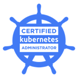
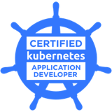
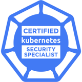
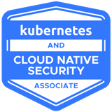
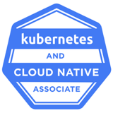
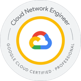
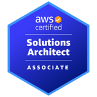
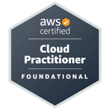

# Hi, I'm Samet 👋

---

### 🚀 About me

- ☁️ I design, automate and operate **cloud infrastructure** on **AWS** and **Google Cloud**
- ☸️ **Kubestronaut** — all five CNCF Kubernetes certifications (CKA · CKAD · CKS · KCNA · KCSA)
- 🏗️ Infrastructure as Code with **Terraform** & **Terragrunt**, GitOps with **ArgoCD** & **Helm**
- 📈 Observability with **Prometheus** & **Grafana**
- 🌍 Open to new opportunities — [get in touch](mailto:samet@sametustaoglu.com)

### 🛠️ Tech stack

  

### 🏅 Certifications

Click a badge to verify it on Credly.

### 🐍 Contributions

<picture>
  <source media="(prefers-color-scheme: dark)" srcset="https://raw.githubusercontent.com/sametustaoglu/SametUSTAOGLU/output/snake-dark.svg" />
  
</picture>
